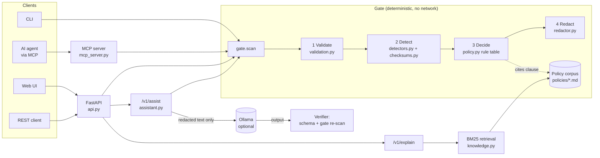

# Design

## Architecture

There's a presentation version with full styling at [architecture.excalidraw](architecture.excalidraw). Open it at https://excalidraw.com (*Open*, then choose the file) or with the VS Code *Excalidraw* extension. The diagram below is the same flow, and it renders directly on GitHub.

## Data flow: `POST /v1/scan`

1. **Validate.** Type, size, control characters. Then NFKC-normalise and strip zero-width characters, which defeats evasion such as full-width digits or `4111​1111…`. Rejected input becomes `BLOCK` with `INPUT_REJECTED:<code>`.
2. **Detect.** Every detector proposes spans, and a checksum or nearby keyword confirms them. Overlapping candidates merge into one span, labelled with the strongest interpretation. Any unclaimed run of 8+ digits is still redacted (`NUMBER_UNCLASSIFIED`).
3. **Decide.** Each type maps to `ALLOW`, `REDACT` or `BLOCK` plus a clause ID, and the strictest rule wins. Eight or more identifiers means `BLOCK` (bulk). An unmapped type means `BLOCK`.
4. **Redact.** Typed placeholders such as `[CARD_NUMBER]`. `released_text` is `null` on `BLOCK`.
5. **Cite.** Each reason carries the clause ID, title and text.

Findings carry **type and position only**. Raw values never leave the function that matched them.

## Component boundaries

| Component | Responsibility | Depends on |
|---|---|---|
| `validation`, `checksums`, `detectors`, `redactor` | Pure functions: text in, findings or text out | stdlib only |
| `policy` | Auditable rule table and decision | detectors |
| `knowledge` | Clause parsing, BM25 index, `explain` with abstain | stdlib only |
| `gate` | Orchestrates the steps; fails closed on any exception | all of the above |
| `api`, `cli`, `mcp_server` | Thin adapters: transport, request IDs, logging | gate, knowledge |
| `assistant` | Optional LLM, wrapped by the gate on both sides | gate, httpx |

The core has no network, database or LLM dependency. That keeps it embeddable as a library, a sidecar or a service.

## Key trade-offs

The full reasoning is in [decisions.md](decisions.md).
- **Deterministic detection over ML/LLM.** Auditable, fast (about 1 ms) and reproducible. The cost: no names or addresses.
- **Retrieval explains, never decides.** A ranking error can't cause a leak.
- **Conservative resolution.** On overlaps the stricter label wins, and unknown long numbers are redacted. Precision is traded for zero leaks.
- **BLOCK returns HTTP 200 with `decision: BLOCK`.** Blocking is a valid outcome. Every error response also carries `decision: BLOCK`.

## Security and privacy

- **No raw PII in logs, error bodies or tool output.**
  - FastAPI's default 422 handler echoes the submitted input, so it's overridden.
  - Exceptions log the type name only.
  - All of this is enforced by tests, by the container smoke test and by a grep of real server logs.
- **Fail closed everywhere:**
  - invalid input, engine exception, unmapped entity type, missing policy corpus (`503`), oversized body (`413`), unhandled error (`500`) — all `BLOCK`;
  - invalid LLM output becomes `invalid_output` (no summary released).
- **LLM isolation.** The model sees only redacted text. Its output is schema-validated and re-scanned (policy DH-7.1). Prompt injection can't leak data the model never received.
- **Supply chain and runtime:**
  - `pip-audit` runs in CI;
  - the container runs as non-root uid 10001 with a read-only root filesystem and `no-new-privileges`;
  - the port is bound to localhost;
  - no secrets are required.
- **Data:** all synthetic. The checksum-valid identifiers are randomly generated or published test numbers, and emails use `example.*` domains.

## Technology choices

| Choice | Why |
|---|---|
| Python 3.11+, FastAPI, Pydantic | Typed request validation, auto OpenAPI docs at `/docs`, small footprint |
| Pure-Python BM25 | No model download, deterministic, enough for a corpus of about 15 clauses |
| Official MCP SDK (`mcp>=2.3,<3`) | Standard agent tool interface; pinned to a major version because 2.x renamed APIs |
| Ollama (optional) | Local, free, no keys; a placeholder for an enterprise-approved model endpoint |
| ruff, pytest, pip-audit, GitHub Actions, Docker | Standard, fast, and the same commands run locally and in CI |

## Likely production / cloud shape

- **Runtime.** The stateless container runs on a managed container platform (e.g. ECS Fargate, EKS or Azure Container Apps) behind an internal API gateway, with mTLS and workload identity. It scales horizontally, with no state to share.
- **Integration modes:**
  - (a) a central `/v1/scan` service;
  - (b) a sidecar or library inside LLM-gateway services, to save a network hop;
  - (c) an MCP server registered in the organisation's approved-tools catalogue.
- **Policy as code.** The policy corpus and rule table are versioned in git and change only through a PR that re-runs the evals. The deployed version is reported in `/health`.
- **LLM.** Replace Ollama with an approved private model endpoint (e.g. Bedrock or Azure OpenAI via private link). Credentials come from a secrets manager, never env files.
- **Observability.** JSON logs go to the central log platform or SIEM. Metrics: decision rate by type, BLOCK rate, `degraded` rate, p95 latency. Alert on a spike in BLOCK rate or `ENGINE_ERROR`.
- **Detection upgrade path.** Add an NER model as one more detector behind the same `Detector` interface, gated by the same evals.
